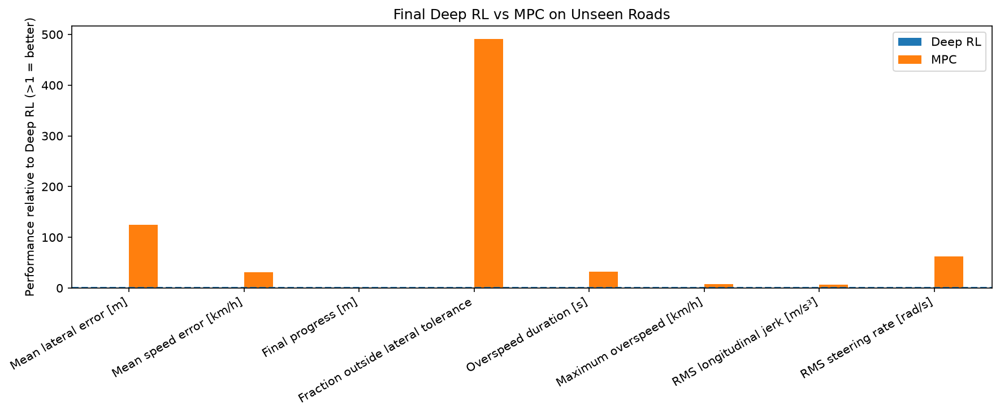

# Deep Reinforcement Learning vs Model Predictive Control

A notebook-based vehicle-control study comparing deep reinforcement learning (RL) with model predictive control (MPC), supported by road construction, controller tuning, reward-shaping experiments, and machine profiling.

**Start with the [saved comparison chart](notebooks/notebook_outputs/final-rl-vs-mpc-comparison/final_policy_comparison.png) and [mean comparison CSV](notebooks/notebook_outputs/final-rl-vs-mpc-comparison/mean_policy_comparison.csv).** You can inspect the findings without rerunning training.

## Recorded results

The checked-in comparison favours MPC across the following measures:

| Metric | Deep RL | MPC |
| --- | ---: | ---: |
| Mean absolute lateral error (m) | 3.8583 | 0.0480 |
| Mean absolute speed error to recommended speed (km/h) | 37.3403 | 2.4556 |
| Final progress (m) | 856.56 | 1,532.76 |
| Fraction outside lateral tolerance | 0.78264 | 0.00078 |
| RMS longitudinal jerk (m/s³) | 12.5745 | 2.7175 |

These numbers are rounded from the [stored aggregate CSV](notebooks/notebook_outputs/final-rl-vs-mpc-comparison/mean_policy_comparison.csv), not a new benchmark. They describe this saved experiment and do not establish that MPC always outperforms RL. The [per-road comparison](notebooks/notebook_outputs/final-rl-vs-mpc-comparison/per_road_comparison.csv) provides a more detailed view.



## Experiment map

| Stage | Notebook |
| --- | --- |
| Construct the roads | [Road construction](notebooks/ad_gym_road_construction_v2026_08_17.ipynb) |
| Profile computation | [Machine profiling](notebooks/ad_gym_machine_profiling_simple_v2026_08_17.ipynb) |
| Define metrics and uncertainty | [Performance metrics](notebooks/ad_gym_performance_metrics_and_uncertainty_2026_08_17.ipynb) |
| Tune a classical baseline | [PID synthesis and tuning](notebooks/ad_gym_pid_synthesis_and_tuning_v2026_08_17.ipynb) |
| Tune and evaluate MPC | [MPC tuning and evaluation](notebooks/ad_gym_mpc_tuning_and_evaluation_v2026_08_21.ipynb) |
| Explore RL rewards and training | [Reward shaping and training](notebooks/ad_gym_rl_reward_shaping_and_training_v2026_08_24.ipynb) |
| Compare the saved policies | [Final RL–MPC comparison](notebooks/ad_gym_final_rl_vs_mpc_comparison.ipynb) |

## Project context

This is a course-based experiment repository. The machine-profiling notebook identifies the University of Melbourne Dream Gym package and pins its upstream version to `v0.2.2`. The simulation package and supplied notebook scaffolding are upstream work; the saved comparisons should be read in that context. Running those workloads also requires authorised access to Dream Gym, beyond the dependencies listed here.

## Tools

Python, NumPy, pandas, SciPy, Matplotlib, Gymnasium, Stable-Baselines3, and PyTorch. The repository also includes saved training outputs and a policy checkpoint.

## Open the notebooks

```bash
python3 -m venv .venv
source .venv/bin/activate
python -m pip install -r requirements.txt
jupyter lab notebooks
```

This installs the listed dependencies; it is not a guarantee that all notebooks run unchanged on a new machine. Review notebook-specific paths and setup before execution. Training time and memory use depend on the experiment and hardware.

## Reproducibility notes

- Some notebooks contain large embedded outputs; GitHub may not render them. Download only the notebook you need or begin with the saved charts and CSVs.
- Dependency versions use lower bounds rather than a fully locked environment.
- The aggregate CSV alone does not establish statistical significance, robustness outside the evaluated roads, or real-vehicle safety.

